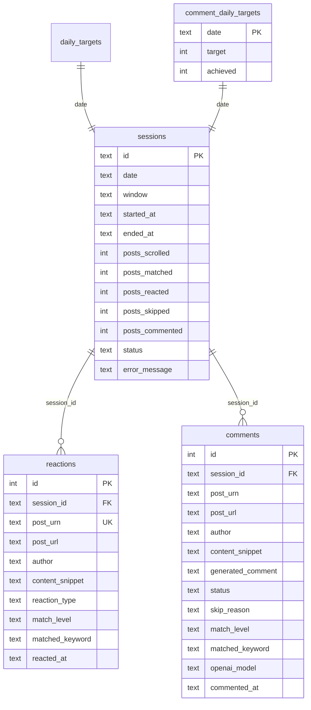

# feat: Add LinkedIn Auto-Comment with OpenAI Integration

## Overview

Extend the existing LinkedIn auto-liker to generate and post AI-powered comments during feed-scrolling sessions. The system reads posts, scrapes existing comments for context, generates a contextual comment via OpenAI API using a custom persona, validates it against safety rules, and types it with human-like keystrokes. Target: 5-10 comments/day on keyword-matched, engaged posts.

## Problem Statement

Liking is low-visibility engagement — a name in a list. Commenting puts your name, face, and words directly in front of the post author and their network. An auto-commenter that generates contextual, persona-consistent comments dramatically increases LinkedIn presence and lead generation potential. (see origin: `docs/brainstorms/2026-03-23-linkedin-auto-comment-requirements.md`)

## Proposed Solution

Integrate commenting into the existing feed-scrolling session loop. After evaluating a post for liking (existing flow), the system evaluates it for commenting using keyword match + engagement threshold. If eligible, it scrapes existing comments, calls OpenAI, validates the output, and posts it with human-like behavior. All new logic follows existing architectural patterns (centralized selectors, prepared SQLite statements, gaussian delays, modular files).

## Architectural Decisions

These decisions were made during brainstorm (see origin) or resolved here for planning:

| Decision | Choice | Rationale |
|----------|--------|-----------|
| LLM Provider | OpenAI API (GPT) | Best ecosystem maturity, configurable model |
| Comment context | Post + existing comments + persona | Produces unique, conversational comments |
| Targeting | Keyword match + engagement threshold | Maximizes visibility and relevance |
| Daily volume | 5-10 comments/day (gaussian) | Plausible for active professional |
| Approval | Autonomous with safety rules | Hands-off with safety net |
| Integration | Combined with auto-liker sessions | Natural behavior pattern |
| Persona | Custom, user-defined | Consistent brand voice |
| Database | New `comments` table (not extending `reactions`) | Different data model; allows like+comment on same post |
| Feature toggle | `ENABLE_COMMENTS=false` by default | Safe rollout, existing users unaffected |
| Dry run mode | `COMMENT_DRY_RUN=true` option | Test persona and safety before posting |
| Action sequence | Like first, then comment (with 2-5s delay) | Natural human pattern |
| Comment spacing | Randomized 3-8 post gap (counter tracks all posts scrolled) | Prevents mechanical pattern |
| Session distribution | Same logic as reactions: `ceil(remaining / remainingSessions)` | Even spread across windows |
| Existing comments | Scrape visible only (no "Load more" expansion) | Safer, faster, sufficient context |
| API failures | 1 retry for 500/503; skip on 401/429; disable after 3 consecutive failures | Resilient without tight loops |
| Repetition detection | Sliding window of last 5 comments; check first-5-word match + Jaccard similarity > 0.6 | Simple, effective, no ML overhead |
| Comment format | Plain text only (no bold/italic/mentions/hashtags) | Simpler, safer for v1 |
| API key security | NOT exposed in GET /settings; separate endpoint for comment config | Prevents dashboard key leakage |

## Technical Approach

### Architecture

```
Existing Flow (unchanged):
  scroll feed → extract posts → keyword match → react → log

New Comment Flow (after reaction):
  ┌─ engagement check (new extraction: like/comment counts)
  ├─ comment quota check (daily target, session target)
  ├─ spacing check (posts since last comment ≥ gap)
  ├─ scrape existing comments on post
  ├─ call OpenAI API (post + comments + persona → generated comment)
  ├─ safety validation (length, banned phrases, punctuation, repetition)
  ├─ human-like typing into comment box
  └─ submit + log to comments table
```

### New Files to Create

| File | Purpose | Lines (est.) |
|------|---------|-------------|
| `src/feed/commenter.js` | Comment box interaction: click, type, submit | ~120 |
| `src/feed/comment-extractor.js` | Scrape existing comments from a post | ~80 |
| `src/ai/comment-generator.js` | OpenAI API integration + prompt construction | ~120 |
| `src/ai/comment-safety.js` | Safety validation rules | ~80 |
| `config/commenting.json` | Persona, banned phrases, engagement thresholds | ~20 |

### Existing Files to Modify

| File | Change | Lines affected |
|------|--------|---------------|
| `src/index.js` | Add comment decision logic after reaction block (~line 276) | +60 |
| `src/feed/extractor.js` | Extract engagement counts (likes, comments) from post DOM | +30 |
| `src/feed/selectors.js` | Add comment-related DOM selectors | +20 |
| `src/database/db.js` | Add `comments` table, `comment_daily_targets`, prepared stmts, query functions | +120 |
| `src/behavior/human.js` | Add `humanType()` for keystroke simulation | +40 |
| `src/config.js` | Add comment config keys | +25 |
| `src/server/api.js` | Add `/api/comments`, `/api/comment-stats`, `/api/persona` endpoints; fix .env write handler | +100 |
| `src/server/public/index.html` | Add Comments page, persona editor in sidebar | +80 |
| `src/server/public/js/app.js` | Add comment page rendering, persona editor | +100 |
| `src/server/public/css/style.css` | Comment badge styles, persona editor styles | +30 |
| `src/reporting/reporter.js` | Add `postsCommented` to session report | +5 |
| `.env.example` | Add `OPENAI_API_KEY`, `OPENAI_MODEL`, comment config vars | +15 |
| `package.json` | Add `openai` dependency | +1 |

### Database Schema

```sql
-- New table for comment tracking
CREATE TABLE IF NOT EXISTS comments (
  id INTEGER PRIMARY KEY AUTOINCREMENT,
  session_id TEXT NOT NULL,
  post_urn TEXT NOT NULL,
  post_url TEXT DEFAULT '',
  author TEXT,
  content_snippet TEXT,          -- post content for context
  generated_comment TEXT,        -- the LLM-generated comment
  status TEXT NOT NULL,          -- 'posted' | 'skipped' | 'failed'
  skip_reason TEXT,              -- safety rule name or error description
  match_level TEXT,
  matched_keyword TEXT,
  openai_model TEXT,
  commented_at TEXT NOT NULL DEFAULT (datetime('now')),
  FOREIGN KEY (session_id) REFERENCES sessions(id)
);

CREATE INDEX IF NOT EXISTS idx_comments_urn ON comments(post_urn);
CREATE INDEX IF NOT EXISTS idx_comments_session ON comments(session_id);
CREATE INDEX IF NOT EXISTS idx_comments_date ON comments(commented_at);

-- Daily comment target tracking
CREATE TABLE IF NOT EXISTS comment_daily_targets (
  date TEXT PRIMARY KEY,
  target INTEGER,
  achieved INTEGER DEFAULT 0
);

-- Extend sessions table
ALTER TABLE sessions ADD COLUMN posts_commented INTEGER DEFAULT 0;
```



### Config Structure

**`config/commenting.json`:**
```json
{
  "persona": "You are a B2B growth strategist with 10+ years of experience in SaaS and lead generation. You share practical insights, ask thoughtful questions, and keep comments concise and genuine.",
  "bannedPhrases": ["as an AI", "language model", "I don't have personal", "I cannot", "whilst", "delve", "leverage"],
  "minEngagementReactions": 5,
  "minEngagementComments": 2,
  "minLength": 15,
  "maxLength": 300
}
```

**New `.env` keys:**
```env
# Auto-Comment
ENABLE_COMMENTS=false
COMMENT_DRY_RUN=false
OPENAI_API_KEY=
OPENAI_MODEL=gpt-4o-mini
DAILY_COMMENT_MIN=5
DAILY_COMMENT_MAX=10
COMMENT_MIN_GAP=3
COMMENT_MAX_GAP=8
```

### OpenAI Prompt Structure

```
System: You are {persona}. Write a brief LinkedIn comment (1-3 sentences) on the following post. Your comment should:
- Add value to the conversation (a perspective, question, or insight)
- Sound natural and conversational, not generic or templated
- Never reveal you are AI or automated
- Never use hashtags or excessive punctuation
- Be between 15-300 characters

Post by {author}:
{post_text}

{if existing_comments:}
Other people's comments on this post:
{comment_1_author}: {comment_1_text}
{comment_2_author}: {comment_2_text}
...

Write a comment that adds something new to this conversation.
{else:}
Be a conversation starter - share a perspective or ask a thoughtful question.
{endif}

User: Write your comment. Output ONLY the comment text, nothing else.
```

### Implementation Phases

#### Phase 1: Foundation (Config, Database, OpenAI Integration)

**Files:** `config/commenting.json`, `src/config.js`, `src/database/db.js`, `src/ai/comment-generator.js`, `src/ai/comment-safety.js`, `.env.example`, `package.json`

**Tasks:**
- [ ] Create `config/commenting.json` with persona, banned phrases, thresholds
- [ ] Add comment config keys to `src/config.js` (ENABLE_COMMENTS, OPENAI_API_KEY, OPENAI_MODEL, daily targets, gap, dry run)
- [ ] Add `openai` npm dependency to `package.json`
- [ ] Create `src/ai/comment-generator.js`:
  - `generateComment(postText, author, existingComments, persona, model)` → calls OpenAI Chat Completions API
  - System prompt with persona injection
  - Handle empty existing comments (conversation starter prompt)
  - Retry logic: 1 retry on 500/503 with 3s delay, skip on 401/429
  - Return `{ comment, model, tokensUsed }` or `{ error, code }`
- [ ] Create `src/ai/comment-safety.js`:
  - `validateComment(comment, recentComments, config)` → `{ valid, reason }`
  - Length check: `comment.length >= minLength && comment.length <= maxLength`
  - Banned phrases: case-insensitive whole-word matching (avoid substring false positives like "AI" matching "said")
  - Excessive punctuation: no more than 1 consecutive `!` or `?`, no more than 2 emoji total
  - Structural repetition: sliding window of last 5 session comments, check first-5-word prefix match OR Jaccard word-set similarity > 0.6
- [ ] Add `comments` and `comment_daily_targets` tables to `src/database/db.js`:
  - Schema creation in `initDb()`
  - Migration: `ALTER TABLE sessions ADD COLUMN posts_commented INTEGER DEFAULT 0` (try/catch pattern)
  - Prepared statements: `insertComment`, `getCommentsToday`, `isAlreadyCommented`
  - Functions: `logComment(sessionId, postUrn, postUrl, author, snippet, comment, status, skipReason, matchLevel, keyword, model)`, `ensureCommentDailyTarget(date, min, max)`, `getCommentDailyProgress(date)`, `isAlreadyCommented(postUrn)`, `getRecentComments(limit)`, `getCommentStats(days)`
- [ ] Add new `.env` keys to `.env.example` with documentation comments

**Success criteria:** Can call `generateComment()` from a test script, get a response, and validate it with `validateComment()`. Database tables created on startup.

#### Phase 2: DOM Interaction (Selectors, Extraction, Typing)

**Files:** `src/feed/selectors.js`, `src/feed/extractor.js`, `src/feed/comment-extractor.js`, `src/feed/commenter.js`, `src/behavior/human.js`

**Tasks:**
- [ ] Research LinkedIn comment DOM selectors (requires manual browser inspection):
  - Comment button: likely `button[aria-label*="Comment"]` or similar
  - Comment input: likely a `contenteditable` div within the comment form (Playwright: click to focus, then `page.keyboard.type()`)
  - Submit button: likely `button[aria-label*="Post"]` or `button.comments-comment-box__submit-button`
  - Existing comments container and individual comment elements
  - Engagement counts: reaction count display, comment count display within post
- [ ] Add comment selectors to `src/feed/selectors.js` (SELECTORS object):
  - `commentButton`, `commentInput`, `commentSubmit`, `commentContainer`, `commentItem`, `commentAuthor`, `commentText`, `engagementReactions`, `engagementComments`
  - Extend `validateSelectors()` to optionally check comment selectors (non-fatal if not found on every post)
- [ ] Extend `extractPost()` in `src/feed/extractor.js` to return engagement counts:
  - Add `reactionCount` and `commentCount` to the returned object
  - Parse text like "42 reactions" or "12 comments" from within post element
  - Default to 0 if not found (don't fail extraction)
- [ ] Create `src/feed/comment-extractor.js`:
  - `extractExistingComments(page, postLocator)` → `[{ author, text }]`
  - Locate comment container within the post element
  - Extract visible comments only (no "Load more" expansion)
  - Cap at 10 comments to limit LLM context
  - Handle posts with 0 comments gracefully
- [ ] Create `src/feed/commenter.js`:
  - `commentOnPost(page, post, commentText, dryRun)` → `{ success, error }`
  - Locate post element (same dual-selector pattern as `reactor.js` lines 18-29)
  - Scroll post into view
  - Click comment button to open comment box
  - Wait for comment input to appear (with retry: move mouse away + retry, same as reaction picker pattern)
  - If `dryRun`: log and return without typing
  - Call `humanType(page, commentInput, commentText)` to type the comment
  - Brief pause (500-1500ms) simulating review before submit
  - Click submit button
  - Verify comment was posted (check for success indicator or comment appearing)
  - On failure: attempt to clear comment box (press Escape or click away) to avoid leaving draft
- [ ] Add `humanType(page, locator, text)` to `src/behavior/human.js`:
  - Click to focus the element
  - Type character-by-character using `page.keyboard.type()` with `delay` option
  - Variable inter-keystroke delay: gaussian(100, 30) ms, clamped to 50-200ms
  - Occasional word-boundary pause: every 4-8 characters, 20% chance of 300-800ms pause
  - No intentional typos in v1 (complexity not worth the risk)
- [ ] Add `thinkingDelay(commentLength)` to `src/behavior/human.js`:
  - Simulates formulating a response before typing
  - Base: 3-8 seconds, scaled slightly by comment length
  - This runs between deciding to comment and clicking the comment box

**Success criteria:** Can type a comment into a LinkedIn post's comment box and submit it. Engagement counts extracted from posts. Existing comments scraped.

#### Phase 3: Session Integration (Main Loop, Quota, Spacing)

**Files:** `src/index.js`

**Tasks:**
- [ ] Load comment config at session start (alongside keyword config, ~line 153):
  - Load `config/commenting.json`
  - Check `config.enableComments` flag — if false, skip all comment logic
  - Instantiate OpenAI client (lazy — only if commenting enabled)
  - Initialize comment quota: `db.ensureCommentDailyTarget(today, min, max)`, calculate `sessionCommentTarget`
- [ ] Add comment tracking variables in session stats (~line 159):
  - `stats.postsCommented = 0`
  - `postsSinceLastComment = 0` (spacing counter)
  - `sessionCommentsFailed = 0` (consecutive API failure counter)
  - `recentSessionComments = []` (for repetition detection)
- [ ] Add comment decision logic in the `onPostsFound` callback, AFTER the reaction block (~after line 276):
  ```
  // Increment spacing counter for every post scrolled
  postsSinceLastComment++

  // Should we attempt a comment?
  if (!config.enableComments) continue
  if (browseOnlySession) continue
  if (sessionCommentsFailed >= 3) continue  // API disabled for this session
  if (stats.postsCommented >= sessionCommentTarget) continue
  if (postsSinceLastComment < commentGap) continue  // spacing rule
  if (!match.matched) continue  // must match keywords
  if (post.reactionCount < minEngagementReactions && post.commentCount < minEngagementComments) continue
  if (db.isAlreadyCommented(post.urn)) continue

  // Generate comment
  const existing = await extractExistingComments(page, postLocator)
  const result = await generateComment(post.text, post.author, existing, persona, model)
  if (result.error) { sessionCommentsFailed++; log; continue }

  // Safety check
  const safety = validateComment(result.comment, recentSessionComments, commentConfig)
  if (!safety.valid) { db.logComment(..., 'skipped', safety.reason); continue }

  // Post comment (or dry run)
  const posted = await commentOnPost(page, post, result.comment, config.commentDryRun)
  if (posted.success) {
    db.logComment(..., config.commentDryRun ? 'dry_run' : 'posted', null)
    recentSessionComments.push(result.comment)
    postsSinceLastComment = 0  // reset spacing counter
    stats.postsCommented++
    // Reset consecutive failure counter on success
    sessionCommentsFailed = 0
  } else {
    db.logComment(..., 'failed', posted.error)
  }
  ```
- [ ] Add delay between liking and commenting on the same post:
  - If post was just reacted to AND will be commented on: `await sleep(humanDelay(2000, 5000))`
- [ ] Update `shouldStop` callback (~line 288) to account for both quotas
- [ ] Update `db.endSession()` call (~line 330) to include `posts_commented`
- [ ] Update `reportSession()` call (~line 340) to include `postsCommented` in payload
- [ ] Add `postsSinceLastComment` to the spacing counter (separate from `postsSinceLastNav` for navigation breaks)
- [ ] Handle session expiry during comment flow: wrap comment block in try/catch, check for auth redirect in catch

**Success criteria:** During a feed session, the system likes posts AND comments on select posts. Comments are spaced, quota-limited, and logged. Dry run mode generates and logs without posting.

#### Phase 4: Dashboard Extension

**Files:** `src/server/api.js`, `src/server/public/index.html`, `src/server/public/js/app.js`, `src/server/public/css/style.css`

**Tasks:**
- [ ] Add API endpoints to `src/server/api.js`:
  - `GET /api/comments?limit=50&offset=0` — paginated comment history (posted + skipped + failed)
  - `GET /api/comment-stats?days=7` — comments by day, by status
  - `GET /api/persona` — read `config/commenting.json` (persona, banned phrases, thresholds)
  - `POST /api/persona` — write `config/commenting.json` (with validation)
- [ ] Fix the POST /settings .env write handler (api.js ~lines 256-299):
  - Add `OPENAI_API_KEY`, `OPENAI_MODEL`, `ENABLE_COMMENTS`, `COMMENT_DRY_RUN`, `DAILY_COMMENT_MIN`, `DAILY_COMMENT_MAX`, `COMMENT_MIN_GAP`, `COMMENT_MAX_GAP` to the write template
  - Do NOT add `OPENAI_API_KEY` to the `ALLOWED_SETTINGS` GET whitelist (security)
  - Add a separate `OPENAI_API_KEY` presence check (returns `true/false`, not the key itself) in GET /api/status
- [ ] Update `GET /api/status` to include comment daily progress (comments today / target)
- [ ] Add sidebar item "Comments" in `index.html`:
  - SVG icon (chat bubble)
  - `data-page="comments"`
- [ ] Add Comments page in `index.html`:
  - Comment history table: timestamp, author, post snippet, generated comment, status badge (posted/skipped/failed), skip reason
  - Clickable post links (same pattern as reactions table)
- [ ] Add Persona editor section (in Settings page or new "AI" page):
  - Textarea for persona prompt
  - Banned phrases editor (comma-separated input or tag-style)
  - Engagement threshold inputs (min reactions, min comments)
  - Comment length bounds (min, max)
  - Save button with toast notification
- [ ] Add comment rendering to `app.js`:
  - `loadComments()` — fetch + render comment history with pagination
  - `loadPersona()` — fetch + populate persona editor
  - `savePersona()` — validate + POST to `/api/persona`
  - Update dashboard page to show comment stats alongside reaction stats
- [ ] Add CSS for comment status badges:
  - `.badge-posted` (green), `.badge-skipped` (yellow), `.badge-failed` (red), `.badge-dry-run` (blue)

**Success criteria:** Dashboard shows comment history, daily comment progress, and allows editing persona/safety config.

## System-Wide Impact

### Interaction Graph

```
Session starts (index.js)
  → loads commenting.json config
  → initializes OpenAI client
  → scroll callback fires per post batch
    → keyword match (existing) → engagement check (new)
    → reactToPost (existing) → delay → comment decision
    → extractExistingComments → OpenAI API call → safety check
    → commentOnPost → humanType → submit
    → db.logComment (transaction: insert comment + increment daily counter)
    → SSE broadcast (existing log pipeline)
  → session ends → endSession includes posts_commented
  → reportSession includes posts_commented → admin server
```

### Error Propagation

| Error | Source | Handling | Impact |
|-------|--------|----------|--------|
| OpenAI 401 (bad key) | `comment-generator.js` | Skip comment, log, don't retry | No comments until key fixed |
| OpenAI 429 (rate limit) | `comment-generator.js` | Skip comment, log, don't retry | Comment skipped, session continues |
| OpenAI 500/503 | `comment-generator.js` | 1 retry after 3s, then skip | Brief delay, then move on |
| 3+ consecutive API failures | `index.js` | Disable commenting for rest of session | Session continues with likes only |
| Comment box not found | `commenter.js` | Skip, press Escape, log as failed | Post not commented, session continues |
| Submit button not found | `commenter.js` | Clear input (Escape), log as failed | Avoid leaving draft text |
| Session expired mid-comment | `index.js` catch block | Existing auth-expiry handling | Session ends cleanly |
| CAPTCHA during comment | `commenter.js` / `index.js` | Existing captcha detection + 24h cooldown | Full session stops |
| Safety check failure | `comment-safety.js` | Skip, log with reason | Comment not posted, session continues |

### State Lifecycle Risks

- **Partial comment draft:** If system types into comment box but fails before submit, LinkedIn may save a draft. Mitigation: press Escape key in the catch block to dismiss the comment form.
- **Daily target double-increment:** Wrap `insertComment` + `incrementCommentTarget` in a transaction (same pattern as `_logReactionTx` at db.js line 229).
- **OpenAI client initialization:** Only create client when `ENABLE_COMMENTS=true` AND `OPENAI_API_KEY` is set. Fail gracefully if key is missing.

## Acceptance Criteria

### Functional Requirements (from origin R1-R10)

- [ ] System generates contextual comments via OpenAI API using a custom persona (R1)
- [ ] Existing comments on a post are scraped and sent as LLM context (R2)
- [ ] Only posts matching keywords AND having minimum engagement are commented on (R3)
- [ ] Commenting runs within the same session as liking (R4)
- [ ] 5-10 comments posted daily with gaussian variance (R5)
- [ ] Safety rules prevent bad comments from being posted (R6):
  - Length bounds (15-300 chars)
  - Banned phrase detection (whole-word, case-insensitive)
  - Excessive punctuation/emoji check
  - Structural repetition check (sliding window)
- [ ] Comments are typed with human-like keystroke delays (R7)
- [ ] All comments (posted, skipped, failed) are logged to SQLite (R8)
- [ ] Persona is configurable via dashboard (R9)
- [ ] Never comment on back-to-back posts; 3-8 post gap enforced (R10)

### Non-Functional Requirements

- [ ] `ENABLE_COMMENTS=false` by default — existing users unaffected
- [ ] `COMMENT_DRY_RUN=true` mode generates and logs without posting
- [ ] OpenAI API failures do not crash the session or disrupt liking
- [ ] API key is not exposed via GET /settings endpoint
- [ ] All existing anti-detection measures (skip days, browse-only, jitter, random navigation) apply to commenting
- [ ] Session duration remains within `MAX_SESSION_MINUTES` bounds (comment time budgeted within)

### Quality Gates

- [ ] Comment generation works with 0 existing comments (conversation starter mode)
- [ ] Comment generation works with 1-10 existing comments (conversation continuation)
- [ ] Safety rules catch all banned phrases without false positives on substrings
- [ ] Repetition detection prevents templated output across posts in a session
- [ ] Human typing looks natural (variable delays, word-boundary pauses)
- [ ] Dashboard correctly displays posted/skipped/failed comments with reasons
- [ ] Persona edits via dashboard take effect on next session

## Dependencies & Prerequisites

- OpenAI API key with billing enabled (user must obtain)
- `openai` npm package (added in Phase 1)
- LinkedIn comment DOM selectors (must be researched during Phase 2 via browser inspection)
- Existing auto-liker infrastructure stable and working

## Risk Analysis & Mitigation

| Risk | Likelihood | Impact | Mitigation |
|------|-----------|--------|------------|
| LinkedIn detects automated commenting | Medium | High — account restriction | Conservative volume (5-10/day), human-like typing, spacing rules, dry run testing |
| LLM generates inappropriate content | Low | High — reputation damage | Safety rules, banned phrases, dry run mode for initial testing |
| LinkedIn DOM changes break comment selectors | Medium | Medium — comments stop working | Centralized selectors file, `validateSelectors()` check, graceful fallback |
| OpenAI API cost escalation | Low | Low — $0.50-1.00/month at volume | No retry loops, skip on rate limit, track usage in logs |
| Comment box is contenteditable (not textarea) | High | Low — different typing approach | Use `page.keyboard.type()` after click-to-focus (works for both) |

## Sources & References

### Origin

- **Origin document:** [docs/brainstorms/2026-03-23-linkedin-auto-comment-requirements.md](docs/brainstorms/2026-03-23-linkedin-auto-comment-requirements.md) — Key decisions carried forward: OpenAI API for generation, autonomous with safety rules, combined sessions with auto-liker, 5-10 comments/day, custom persona.

### Internal References

- Main orchestration loop: `src/index.js:224` (onPostsFound callback)
- Reaction execution pattern: `src/feed/reactor.js:15` (reactToPost — model for commentOnPost)
- DOM selectors: `src/feed/selectors.js:7` (SELECTORS object — extend for comments)
- Post extraction: `src/feed/extractor.js:9` (extractPost — extend for engagement counts)
- Database schema: `src/database/db.js:19` (initDb — add comments table)
- Human behavior: `src/behavior/human.js:73` (humanClick — model for humanType)
- Config loading: `src/config.js:29` (config object — extend for comment keys)
- Dashboard API: `src/server/api.js:47` (ALLOWED_SETTINGS — security boundary for API key)
- Session reporting: `src/reporting/reporter.js:12` (reportSession — extend payload)
- Dashboard HTML: `src/server/public/index.html:26` (sidebar nav — add Comments item)
- Dashboard JS: `src/server/public/js/app.js:192` (renderRecentActivity — model for comment rendering)
- Migration pattern: `src/database/db.js:68` (ALTER TABLE in try/catch)
- Transaction pattern: `src/database/db.js:229` (_logReactionTx — model for logComment)
